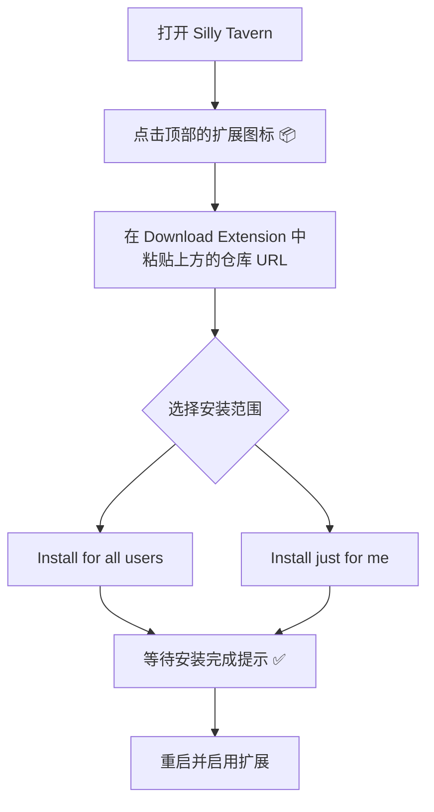

# Response Linter

基于 [il1umi/Response-Linter](https://github.com/il1umi/Response-Linter) 的个人维护分支。

一个强大的 SillyTavern 扩展，用于实时监控和智能修复 AI 回复格式。


## 📋 功能概览

Response Linter 是一个专为 SillyTavern 设计的扩展，能够：

- ⚡ **实时验证** - 在 AI 回复渲染前自动检测格式问题
- 🎯 **位置感知验证** - 智能检测标签的位置和顺序关系
- 🔧 **智能自动修复** - 基于多种策略自动修复常见格式问题
- 📊 **详细错误报告** - 提供具体的错误类型和位置信息
- 🎨 **直观配置界面** - 简洁易用的规则管理和配置向导
- 📈 **统计分析** - 实时监控验证和修复效果

## 🏗️ 项目结构

```
Response-Linter/
├── 📁 core/                           # 核心功能模块
│   ├── auto-fix-engine.js            # 自动修复引擎
│   ├── backend-controller.js         # 后端控制器
│   ├── fix-coordinator.js            # 修复协调器
│   ├── message-handler.js            # 消息处理器
│   ├── message-modifier.js           # 消息修改器
│   ├── host-context.js               # 每次现取宿主 getContext / 消息身份
│   ├── reasoning-sanitizer.js        # 泄漏推理块纯文本清理
│   ├── calendar-engine.js            # 历法描述符校验、日期解析/推进
│   ├── calendar-awareness.js         # 只读自动历法状态与聊天切换/Gouhua 事件
│   ├── structure-profiles.js         # 版本化结构档案、迁移、校验与推理锚点
│   ├── structure-repair.js           # 档案驱动的正文/时间/末尾结构块纯转换
│   ├── sdc-boundary.js               # 1.4.7 兼容的 SDC/content 纯转换
│   ├── details-repair.js             # 1.4.7 兼容的正文外 <details> 纯转换
│   ├── quick-reply-command.js        # /response-linter-fix 斜杠命令
│   ├── quick-reply-descriptor.js     # 捆绑 QR 运行时描述符
│   ├── quick-reply-installer.js      # 幂等 Quick Reply 安装/恢复
│   ├── repair-service.js             # 手动/自动/预览共享修复计划
│   ├── settings-transfer.js          # 结构档案/历法/开关/关键词导入导出
│   ├── text-scan.js                  # 代码围栏/行内代码保护扫描
│   └── validation-engine.js          # 验证引擎
├── 📁 presentation/                   # UI表现层
│   ├── 📁 modules/                   # UI模块 (v1.2新增)
│   │   ├── config-wizard-ui.js       # 配置向导UI模块
│   │   ├── main-panel-ui.js          # 共享主浮层、wand/抽屉启动器
│   │   ├── structure-profile-ui.js   # 结构档案表单、排序与草稿
│   │   ├── rule-editor-ui.js         # 规则编辑器UI模块
│   │   ├── rules-manager-ui.js       # 规则管理器UI模块
│   │   ├── ui-module-manager.js      # UI模块管理器
│   │   └── ui-state-manager.js       # UI状态管理器
│   ├── 📁 quick-reply/               # 捆绑 QR 描述符文件
│   │   └── response-linter-fix.qr.json
│   ├── 📁 styles/                    # 样式文件
│   │   └── main.css                  # 主样式表
│   └── 📁 templates/                 # HTML模板
│       ├── rule-editor.html          # 规则编辑器模板
│       └── settings.html             # 主设置模板（共享浮层内容）
├── 📄 index.js                       # 主入口文件 (支持模块化架构)
├── 📄 manifest.json                  # 扩展清单文件
├── 📄 README.md                      # 项目文档
└── 📄 LICENSE                        # 许可证文件
```

### 🆕 v1.4.8 结构配置档案、自动历法、wand 面板与 Quick Reply

本版把 1.4.6/1.4.7 固定的 SDC/content/details 行为迁移为**版本化结构配置档案**，同时保留旧设置、旧规则和旧开关。

**职责边界（重要）**
- **普通验证规则**负责“必需内容/顺序/用户自定义修复策略”，仍是精确文字匹配；不会自动改成 HTML/XML 解析。
- **结构配置档案**负责正文分隔符、时间模式、外部辅助标记和有序末尾结构块；只由结构开关驱动，不修改用户禁用的规则或内容项。
- 手动修复、自动修复、预览、确认、撤销仍走同一个 `buildRepairPlan → messageModifier` 路径；只有一次结构转换，不再在档案修复后追加固定旧标签二次清理。

**结构档案**
- 旧设置首次加载会自动派生内置“旧版 SDC / content / details”预设并写回版本化列表，不要求用户点击保存，也不会重置 enabled/autoFix/rules/通知/历法字段。
- 内置旧版预设的末尾块实际顺序为 **“内心独白”在前、“你的选择是”在后**；这与 1.4.7 的交换结果一致，而不是反向声明。旧关键词字段仍只影响这个内置预设。
- 支持新建、复制、删除自定义档案、恢复/选择旧版预设；选择空/不存在/重复身份会保留上次有效档案。无效编辑和导入不会覆盖有效配置，编辑器草稿在错误、关闭/重开面板后保留。
- 正文表单支持开始/结束分隔符；时间模式 `none` / `sdc` / `custom`；自定义开始/结束模板必须各含且仅含一个 `{date}`、`{weekday}`、`{time}`，以实际分隔符开头结尾，占位符之间必须有字面分隔符，并拒绝互相可匹配的含糊模板。字面分隔符与自定义时间模板的字面部分大小写精确；HTML 标签名大小写不敏感且开始标签可带属性。正文/结构块标签必须同名成对。时间占位符按模板顺序取最短匹配，每个字段最多 200 字符；缺失分隔符的畸形标记只保留原文，不会跨分隔符反复回溯。
- 外部标记按“辅助标记或已配置末尾结构块开始标签”的最早位置界定正文外区域，分隔线保留在外部侧。无时间模式只修复正文边界，不需要历法；已有时间结束标记逐字节移动，只有缺失结束标记才用当前历法推进并合成。
- 末尾结构块按档案顺序重排到原占位；只处理完整、唯一、顶层目标。中间文字、未知块、平衡嵌套和末尾附加块不改。缺闭合仅在“未闭合外层是配置角色之一，且直接子块是明确不同的配置角色、末尾无归属不明文字”时安全补闭合。重复目标、同时匹配多个身份或结构不明只警告。
- 推理清理的未闭合锚点使用当前档案的正文开始分隔符/时间开始标记，不回退到无关的旧 `<content>`/SDC 锚点。
- 导入导出包含版本的档案、当前选择和既有结构/历法/关键词字段；兼容 1.4.6/1.4.7 导入和直接自定义历法 JSON。导入全有或全无，拒绝原型污染键、重复 id/名称、过长字段、非法占位符和分隔符冲突。导入上限与最大受支持导出（40 档案 × 20 块）一致。

**自动历法**
- 构画/当前聊天来源只读 `ctx.chatMetadata["sp-store"].data["caldesc-user"]`，不写构画、不执行其模块、不编造回退历法。
- 在初始化、聊天切换、打开主面板和 `st-sevendayscal:calendar-changed` 事件后自动刷新状态；手动“检测历法”只是可选二次检查。已有四季预设/自定义 JSON 选择不会被自动识别替换。
- 时间模式为 `none`、或无缺失结束标记而只是移动既有标记时，不读取历法、不产生历法错误；后台刷新不重复 toast。

**wand 与 Quick Reply**
- 主设置只有一个共享 DOM，位于可访问浮层；扩展抽屉与 `#extensionsMenu` 只放小启动器。浮层支持 Escape、基本焦点循环、390px 宽度下的换行/全宽字段，并让规则编辑器/预览弹窗位于其上。关闭/重开保留未保存档案草稿。
- 捆绑 QR 描述符 `presentation/quick-reply/response-linter-fix.qr.json`；运行时只通过 `globalThis.quickReplyApi` 安装唯一自有 set/button，绝不替换同名 set。唯一斜杠命令 `/response-linter-fix` 在导入/创建 QR 前注册；冲突时警告并跳过，不覆盖。
- 按钮执行与“手动修复最新消息”相同的动作，遵守启用状态、预览/应用偏好、流式保护与消息/swipe 身份校验；不发送用户/AI 消息、不生成回复、不在启动/聊天/消息事件自动执行。
- 首次安装激活自有组为可见；之后不重复自动激活，不重装用户删除/禁用的按钮；“手动重试 / 恢复按钮”会重装并在显式恢复时重新激活。API 缺失/禁用时显示状态，仅做有界重试，APP_READY 之后仍可再检查。

**千千结（ST-MyriadKnots）/构画兼容性（不夸大）**
- 只保留消息文本/显示文本/当前 swipe 的既有同步写入；不碰 `extension.store`、QQJ 命名空间、QQJ 存储/迁移，也不创建替代存储。
- 修复、撤销和保存失败回滚保留 `extra.qianqianjie_floor`、`qqj_v3_recall_receipt`、`qianqianjieAutoHide`、`qianqianjie_memory_excluded` 等 QQJ 键、所有 `swipe_info.extra`、其它插件 `extra` 键和 `chatMetadata.qianqianjie`/`sp-store`。撤销是文本快照，不会回滚修复后 QQJ 新写入的元数据。
- 不发送假的 GENERATION/MESSAGE_RECEIVED，也不主动发 MESSAGE_EDITED；不调用 QQJ 公共桥读取完整记忆或把它当作忙碌锁。
- 使用自定义 `<正文>` 等标签时，千千结/构画需要在其共享正文包装设置中配置相同标签；本扩展不会自动写那边设置，也不会声称标签已自动同步。当前 content 预设保持不变。
- 千千结同时保存 raw 与 canonical 指纹。默认畸形 SDC/content/details 示例的 canonical 叙述通常不变但 raw 指纹会变；自定义/更复杂正文可能改变 canonical 正文。修复不会承诺“对记忆零影响”或自动更新已存摘要。建议在记忆提取前应用修复；已记忆后再改语义正文，请使用千千结自己的复核/重处理流程。本扩展不自动重建记忆、不强制提取。

**已知限制**
- 结构档案是受限描述符，不是完整 HTML/XML 解析器；非标签字面分隔符不做大小写折叠，HTML 标签只按名称/属性/大小写规则匹配。
- 只在无外部标记时以正文结束分隔符保护未知外部尾部；正文边界严重错位且无任何可识别外部标记时仍可能保守不动。
- 自定义时间模板不支持正则、`eval`、未知占位符、闰月规则或古典中文数字日期；日期格式和推进仍由现有历法引擎负责。时间字段是日历标签而不是自由段落，单字段上限 200 字符，且不能包含紧随其后的字面分隔符。
- Quick Reply 仅支持宿主公开 API；未暴露 API、扩展禁用或斜杠命令冲突时不会旁路安装。
- 自动化与仓库内浏览器夹具不能替代真实 TauriTavern 2.4.0 / Windows / Android 设备和其它扩展组合验收。真实 TT 的 wand 菜单、弹窗栈、QR 生命周期仍需人工验收。

### 🆕 v1.4.7 正文外折叠块顺序与配对修复

新增**默认关闭、独立于另外两个开关**的“修复正文外折叠块顺序与配对”。它只在回复已经带有 SDC-start / SDC-end、且 SDC-end 与 `</content>` 之间仅有空白/换行时，处理 `</content>` 之后的顶层 `<details>`。标题关键词可配置，默认 `内心独白` 与 `你的选择是`：

- 只交换这两个目标块。当“你的选择是”排在“内心独白”之前时，把两个完整块放回各自的原槽位；两个块之间的普通文字、未知折叠块、末尾新增或未来的 `<details>` 全部原样保留。正确顺序、没有目标对、重复目标或标题同时匹配两个关键词时不猜测，后者会给出警告并保留原文。
- 缺少 `</details>` 时，只有未闭合外层本身是目标角色之一（“内心独白”或“你的选择是”），且紧随其后的完整折叠块是另一个相反目标角色，并且末尾没有归属不明文字时才补闭合；未知标题或未知外层的未闭合结构不会被当作并列证据，完全平衡的嵌套结构也不会被扁平化。标题或层级不明确、末尾文字归属不明、正文外出现 `<content>`、重复目标等情况只警告并保留原文。
- 代码围栏、行内反引号、`<code>`/`<pre>` 内容以及 HTML 注释中的 `<details>` 示例不参与扫描；标签大小写和属性均可识别，目标块交换时保持原字节，不由正文生成新 HTML。
- 与“修复 SDC / 正文边界”相互独立。只开边界修复不会重排折叠块；只开本开关不会隐式移动 `</content>`，目标块仍被正文包住时会警告跳过；两者同时开启时先修复边界、再排序折叠块，并保持 SDC-end 紧贴 `</content>` 的不变式。
- 共用既有的手动修复、自动修复、预览确认和撤销路径；没有普通规则也可以使用。设置导入导出包含新开关与两个标题关键词；旧设置或旧导出缺少字段时按关闭和默认关键词处理。

**已知边界**：不处理没有 SDC 标记的普通回复；不识别嵌套在其它 `<details>` 内部的目标标题（平衡嵌套会原样保留）；无法确定缺失闭合标签归属时不补闭合；不会为了排序去猜测或移动正文边界。

### 🆕 v1.4.6 回复结构清理与 SDC 边界修复

新增两个**默认关闭、彼此独立**的开关（不依赖用户规则，也不会重置原有规则）：

- **清理泄漏的推理块**：删除完整的 `<think>…</think>` / `<thinking>…</thinking>`。未闭合块只有在后面出现明确 `<content>` 或 SDC-start 锚点时，才删除到锚点之前；否则保留原文并警告。Markdown 围栏、行内代码、`<code>`/`<pre>` 内容一律不改。
- **修复 SDC / 正文边界**：仅处理带 SDC 标记的正文，把 `<!-- SDC-end … -->` 和 `</content>` 移回正文末尾、`<版权水印>` / 分隔线 `---` / `<details>` 之前；结束注释必须紧贴 `</content>`，中间只允许空白/换行。缺少结束注释时，才根据 SDC-start 与历法按“推进分钟”（默认 10）合成；已有结束注释原字节保留，即使日期格式不常见。普通回复或只是移动已有标记时不需要历法，也不会出现无关的“历法缺失”警告。

两个功能共用既有的手动修复、自动修复（仅在“启用智能自动修复”打开时自动执行）、预览确认和撤销路径，底层仍只通过 `messageModifier` 写入。手动修复不要求存在用户规则；流式生成期间不写入。

SDC 历法来源：

1. **构画 / 当前聊天（默认，只读）**：只读当前聊天在构画中设置的历法，不导入或执行构画模块，不写入其元数据；切换聊天或修改构画历法后，下一次修复立即使用新历法。只有需要补写缺失的结束注释时才读取历法。
2. **四季 28 日预设**：春夏秋冬各 28 天，周一…周日，日期 `{year}年{month}{day}日`。
3. **自定义 JSON**：可编辑 textarea，按顺序填写月份名称与每月天数、按顺序填写星期名称，日期格式必须包含 `{year}`、`{month}`、`{day}`（可选用 `{era}` 与纪年名），并可设置推进分钟。首次切到自定义来源会填入一份有效可编辑草稿；非法编辑会保留上次有效配置，同时让草稿继续显示，不会把输入框藏起来。非法 JSON、重复月名、越界天数、重复日期占位符、未知类型、未支持的闰月规则或原型污染属性会被拒绝。

界面中的“检测历法”会显示来源与实际月份。结构清理/历法配置可导出、导入并持久化到扩展设置；旧版本设置中没有这些字段时按关闭处理。

**已知边界（不夸大）**：不会修改宿主 `extra.reasoning` 等推理字段；不会猜测缺失的 SDC-start、重复/多 `<content>` 或结构不明的内容；不支持古典中文数字日期与自定义历法闰月；没有在真实 TauriTavern、Windows 或 Android 设备上做验收，自动化仅覆盖模拟宿主下的核心与集成路径。

### 🆕 v1.4.5 修复更新

- 修复手动修复的验证结果接口；关闭自动修复后仍可手动修复，并返回实际处理结果。
- 禁用内容项保留在规则中，检测及位置修复时跳过；新增、编辑和取消操作使用独立草稿。
- 接通撤销入口、历史查询及统计重置；撤销同步恢复原始文本、显示文本和当前候选回复，并保存聊天。
- 修复失败时回滚内存状态；预览期间消息已编辑或聊天已切换时拒绝覆盖。
- 重复内容使用不同匹配位置进行顺序校验，修复代码块模板误报。
- 修复预览接口、修复次数统计及旧策略名称兼容；不再回退执行未选择的标签清理策略。

规则内容仍按精确文字匹配，不提供完整 XML/HTML 语法解析。撤销历史仅保存在当前页面内存中，刷新后不可撤销。

## 🆕 v1.4 更新摘要

- 修复：稳定获取 getContext，解决 ReferenceError 导致的消息修改失败
- 修复：消息修改会同步写入 message.mes，并在成功后触发轻量保存，刷新后仍然生效
- 增强：updateMessageBlock 调用桥按优先级回退，兼容更多环境
- 修复：放宽规则保存前置检查并镜像设置，提升导入与编辑规则的保存成功率
- 文档：README 与 manifest 版本更新到 1.4.0

## 🚀 快速开始

### 安装

#### 方法一：通过 Git 克隆安装（适合开发者）

1.  **进入扩展目录**
    打开终端或命令行工具，进入 SillyTavern 的第三方扩展目录。
    ```bash
    cd SillyTavern/public/scripts/extensions/third-party/
    ```
2.  **克隆仓库**
    使用 `git clone` 命令下载本仓库。
    ```bash
    git clone https://github.com/qiyuebuyuan1993/Response-Linter.git
    ```
3.  **重启并启用**
    - 重启您的 SillyTavern 实例。
    - 打开 "扩展" 面板，找到 "Response Linter" 并启用。

#### 方法二：通过 URL 在线安装（酒馆内直装，推荐）

这是一个更简单快捷的安装方式，直接在 SillyTavern 界面内完成。请复制以下 URL 地址：
`https://github.com/qiyuebuyuan1993/Response-Linter`



### 基础使用

1. **打开主面板**
   - 从扩展抽屉的“打开设置”或 wand 菜单（#extensionsMenu）中的“响应检查器”进入同一个共享设置面板；两个入口都保留，宿主缺少任一时另一入口仍可用。
   - 面板关闭/重开不会清空未保存的结构档案草稿。

2. **启用验证与规则**
   - 在共享面板中打开“启用响应检查器”，使用“快速添加常用规则模板”或“添加新规则”配置必需内容/顺序/修复策略。
   - 普通规则仍只做精确文字匹配，不是完整 HTML 解析器。

3. **选择或编辑结构档案**
   - 旧用户会自动获得“旧版 SDC / content / details”预设；可新建/复制自定义档案，按普通表单填写正文分隔符、时间模式、外部标记和末尾结构块顺序，无需编辑代码或 JSON。
   - 末尾块使用上移/下移排序；只有完整、唯一、顶层目标会被重排。旧版预设实际顺序是内心独白在前、选项在后。

4. **启用结构开关**（可选，默认关闭）
   - “清理泄漏的推理块”“修复正文 / 时间边界”“修复正文外结构块顺序与配对”彼此独立；不创建用户规则也能手动修复。自动执行还需打开“启用智能自动修复”；预览偏好会先展示完整转换文本。
   - 时间模式 `none` 不需要历法；已有结束标记逐字节移动，只有缺失标记才按“推进分钟”合成。

5. **历法来源**
   - 默认“构画 / 当前聊天（只读）”自动读取当前聊天历法；打开面板、切换聊天或构画历法变更事件后刷新状态，不写构画数据，也不会替换你显式选择的四季预设/自定义 JSON。
   - 没有历法描述符或描述符无效时只警告；缺失结束标记不会凭空编造日期。手动“检测历法”是可选二次检查。

6. **Quick Reply 修复按钮**
   - 首次加载会在 Quick Reply 扩展可用且启用时安装一个自有按钮；命令冲突、API 缺失或 QR 禁用时显示状态且不旁路安装。
   - 按钮与手动修复同一动作，不发送消息/不生成回复。删除按钮后不会被自动重装；在主面板点“手动重试 / 恢复按钮”才会重新安装。

7. **千千结/构画自定义标签**
   - 使用自定义 `<正文>` 等标签时，必须同时在千千结/构画的共享正文包装设置中配置相同标签；本扩展不会自动改那边设置，当前 content 预设保持不变。
   - 修复/撤销保留 QQJ 的 floor anchor、receipt、auto-hide、memory-exclusion、`swipe_info.extra` 和 `chatMetadata.qianqianjie`；不碰 QQJ 存储。建议在记忆提取前修复；已记忆后再改语义正文，请使用千千结自己的复核/重处理流程。

8. TauriTavern / SillyTavern 使用同一共享设置面板；界面目标是 390px 宽度可换行/全宽字段，但本次未在真实 TauriTavern 2.4.0 / Windows / Android 设备上完成移动视口验收，请先在预览模式验证再开启自动修复。

## 🎯 核心功能详解

### 验证引擎

#### 位置感知验证
- **顺序检测**：确保标签按预期顺序出现
- **完整性检查**：验证配对标签的完整性
- **内容位置分析**：检测标签在文本中的具体位置

#### 错误分类
- 🔴 **标签缺失**：检测缺少的必需标签
- 🟡 **顺序错误**：标签出现但顺序不正确
- 🟠 **配对不完整**：开始标签存在但缺少结束标签

### 智能修复系统

#### 修复策略

1. **思维链修复策略** (`ThinkingContentFixStrategy`)
   - 自动处理 `</thinking>` 后缺失 `<content>` 的情况
   - 智能添加内容包装标签

2. **缺失标签修复策略** (`MissingTagsFixStrategy`)
   - 自动补全缺失的配对标签
   - 智能判断插入位置

3. **位置感知修复策略** (`PositionalFixStrategy`)
   - 基于内容上下文的智能修复
   - 支持双换行符分隔模式
   - 针对不同场景的个性化修复逻辑

4. **自定义修复策略** (`CustomFixStrategy`)
   - 支持用户定义的正则表达式修复规则
   - 灵活的替换模式配置

### 用户界面

#### 主控制面板
- **扩展状态控制**：启用/禁用验证和修复功能
- **规则管理器**：添加、编辑、删除验证规则
- **通知设置**：配置错误提示的显示方式
- **统计显示**：实时查看验证和修复统计

#### 规则编辑器
- **直观配置界面**：简单易用的规则创建向导
- **拖拽排序**：可视化调整标签检测顺序
- **实时预览**：即时查看修复策略效果
- **模板支持**：预置常用规则模板

#### 配置向导
- **分步指导**：四步配置流程，新手友好
- **模式选择**：思维链、结构化、自定义三种模式
- **测试功能**：配置完成后即时测试验证效果

## 📖 使用指南

### 创建验证规则

#### 方法一：使用模板（推荐新手）

1. 点击"快速添加常用规则模板"
2. 选择合适的模板：
   - **思维链模板**：验证 `<thinking>` 和 `<content>` 结构
   - **代码块模板**：验证代码标签的完整性
   - **问答模板**：验证问答格式的标准化

#### 方法二：使用配置向导

1. 点击"配置向导"按钮
2. 选择验证模式
3. 配置必需内容
4. 测试验证规则
5. 完成配置

#### 方法三：手动创建

1. 点击"添加新规则"
2. 填写规则信息：
   - **规则名称**：便于识别的名称
   - **规则描述**：详细说明规则用途
   - **必需内容**：需要验证的标签列表
   - **修复策略**：选择适当的自动修复方式

### 配置修复策略

#### 位置感知修复（推荐）
- 智能分析内容上下文
- 在最合适的位置插入缺失标签
- 支持双换行符分隔，保持格式美观

#### 思维链修复
- 专门处理思维链格式问题
- 自动在 `</thinking>` 后添加 `<content>` 标签

#### 缺失标签修复
- 通用的标签补全策略
- 适用于各种配对标签场景

#### 自定义修复
- 使用正则表达式定义修复规则
- 高度灵活，适合特殊需求

### 理解验证结果

#### 通知类型
- **成功**：回复通过所有验证规则
- **警告**：发现格式问题但可以修复
- **错误**：发现严重格式问题

#### 详细信息
- **错误类型**：标签缺失、顺序错误、配对不完整
- **具体位置**：问题出现的行号和位置
- **修复建议**：推荐的修复方案

## ⚙️ 高级配置

### 性能优化

#### 验证设置
- **防抖延迟**：避免频繁验证影响性能
- **消息缓存**：防止重复处理相同消息
- **内存管理**：自动清理过期的处理记录

#### 修复设置
- **修复队列**：按优先级处理修复任务
- **确认机制**：重要修复需要用户确认
- **撤销功能**：支持撤销最近的修复操作

### 扩展开发

#### 自定义修复策略
```javascript
// 创建自定义修复策略
const myStrategy = new CustomFixStrategy(
  '(</thinking>)(?!\\s*<content>)', // 正则模式
  '$1\n\n<content>\n',              // 替换内容
  '自定义思维链修复'                 // 策略描述
);

// 注册策略
autoFixEngine.registerStrategy('my-custom', myStrategy);
```

#### 事件监听
```javascript
// 监听验证事件
eventSource.on('responseLinter.validationFailed', (result) => {
  console.log('验证失败:', result);
});

// 监听修复事件
eventSource.on('responseLinter.fixApplied', (result) => {
  console.log('修复完成:', result);
});
```

## 📊 统计与监控

### 验证统计
- **总验证次数**：扩展启动以来的验证总数
- **失败验证次数**：发现问题的验证次数
- **成功率**：验证通过的百分比

### 修复统计
- **修复尝试次数**：自动修复的尝试次数
- **修复成功次数**：成功修复的次数
- **用户取消次数**：用户拒绝修复的次数
- **修复成功率**：修复成功的百分比

### 性能监控
- **平均验证时间**：每次验证的平均耗时
- **内存使用情况**：扩展的内存占用
- **错误日志**：记录运行中的异常情况

## 🔧 故障排除

### 常见问题

#### 扩展无法加载
1. 检查文件路径是否正确
2. 确认 `manifest.json` 格式正确
3. 查看浏览器控制台错误信息

#### 验证不生效
1. 确认扩展已启用
2. 检查是否有活跃的验证规则
3. 验证规则配置是否正确

#### 修复功能异常
1. 确认智能修复已启用
2. 检查修复策略配置
3. 查看修复历史记录

### 调试模式

启用调试模式查看详细日志：
```javascript
// 在浏览器控制台中执行
window.responseLinterDebug = true;
```

### 重置设置

如需重置所有设置：
```javascript
// 清除所有配置
delete extension_settings['response-linter'];
location.reload();
```

##  贡献指南

欢迎社区贡献！请遵循以下步骤：

1. **Fork 项目**
2. **创建功能分支** (`git checkout -b feature/XFeature`)
3. **提交更改** (`git commit -m 'Add some XFeature'`)
4. **推送分支** (`git push origin feature/XFeature`)
5. **创建 Pull Request**

### 开发环境

- Node.js 16+
- SillyTavern 最新版本
- 支持 ES6 模块的现代浏览器

### 代码规范

- 遵循 ES6+ 标准
- 保持高内聚低耦合的架构设计

## 📄 许可证

本项目采用 GNU AGPLv3 许可证 - 查看 [LICENSE](LICENSE) 文件了解详情。

### 版权信息

Copyright (C) 2025 il1umi

##  支持与反馈

- **Issues**：[GitHub Issues](https://github.com/qiyuebuyuan1993/Response-Linter/issues)
- **讨论**：[GitHub Discussions](https://github.com/qiyuebuyuan1993/Response-Linter/discussions)
